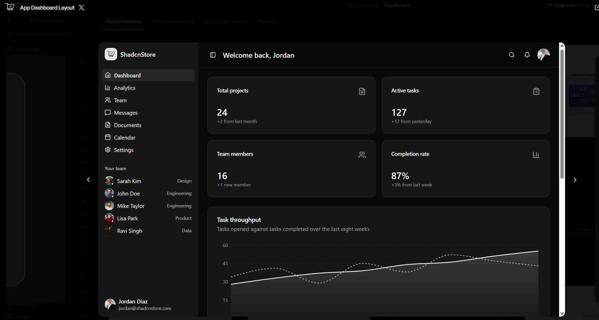

# Panel administrativo: negocios y suscripciones

**Fecha:** 14 de octubre de 2026. **Estado:** especificación documental y selección preliminar de referencias; panel, contratos, pruebas e integración con proveedores pendientes. Esta revisión no acredita una auditoría completa de 21st.dev ni una conexión al MCP.

## 1. Objetivo y alcance confirmado

El propietario de la plataforma necesita revisar negocios y su suscripción comercial desde una administración Next.js clara, rápida y coherente con Foodtrucks. El MVP confirmado comprende **negocios y suscripciones**, con incidencias y actividad auditada que permitan gestionar ambos. Conservar la identidad existente, modo claro/oscuro y las reglas de [UX/UI](04-ux-ui.md) y [Design System](05-design-system.md).

| Incluido en este MVP administrativo | Resultado esperado |
| --- | --- |
| Negocios | Lista, búsqueda, filtros, ficha, alta y edición de datos autorizados; facultad de aprobar o suspender con motivo y confirmación |
| Suscripción comercial | Consulta de licencia inicial, mensualidad, estado Billing e historial de facturas |
| Connect | Consulta separada de situación y requisitos necesarios para vender; no administrar documentos KYC desde este panel |
| Incidencias | Lista y ficha de incidencias relacionadas con negocios y suscripciones; tratamiento autorizado y trazable |
| Actividad | Consulta de acciones administrativas relevantes, su resultado y su contexto mínimo |

La facultad de aprobar/suspender está incluida. **Criterios de aprobación, documentos exigidos, automatización, revisión manual obligatoria y reglas que conectan aprobación con publicación/ventas siguen pendientes.** Esta pantalla no decide esos contratos por su apariencia.

No añadir al menú de este MVP gestión completa de clientes, pedidos, devoluciones, promociones, financiación de descuentos, balances financieros, equipos, proyectos, API keys o mensajería. El pago de pedidos existentes puede requerir un estado mínimo o vínculo de contexto para tratar una incidencia, sujeto a permiso, sin abrir una sección completa de pedidos. La capacidad operativa del administrador y el detalle de las incidencias deben cerrarse antes de implementar sus mutaciones.

La **licencia inicial y mensualidad comercial no tienen tarifa definitiva**. Los 5,99 €/mes pertenecen a la [membresía cliente](25-suscripcion-clientes-fidelizacion.md), no a esta suscripción del negocio. No usar los importes de las demos como tarifas Foodtrucks. Véanse [decisiones](23-decisiones-pendientes.md), [flujo comerciante](03-flujo-comerciante.md) y [Stripe](13-stripe.md).

## 2. Referencias visuales aportadas y adaptación

Las capturas son referencias proporcionadas por el usuario, conservadas en el paquete. Su inspección visual no prueba interacciones, responsive, accesibilidad, licencia o autoría del código subyacente. No reutilizar automáticamente logotipos, retratos, textos comerciales o recursos de terceros.

| Captura | Qué conservar | Qué adaptar o dejar pendiente |
| --- | --- | --- |
| [01. Dashboard](assets/referencias-ui/01-dashboard.png) | Sidebar legible, cabecera, separación del contenido, tarjetas sobrias y jerarquía | Sustituir toda información de proyectos/equipo por negocio Foodtrucks; retirar contenido ajeno al MVP |
| [02. Calendario](assets/referencias-ui/02-calendar.png) | Selector compacto, mes/año, navegación y fecha seleccionada visible | Solo filtros de fechas administrativos; autor/componente exactos de la captura no identificados |
| [03. Novedades](assets/referencias-ui/03-whats-new.png) | Jerarquía de una comunicación, icono, texto y acción principal | Su referencia a voz y su acento azul no añaden una función de voz ni sustituyen el color de marca |
| [04. Indicadores de pasos](assets/referencias-ui/04-step-indicators.png) | Referencia de orientación para procesos que realmente tengan pasos | No convertir cada ficha administrativa en un wizard ni añadir fases comerciales no aprobadas |
| [05. Idioma](assets/referencias-ui/05-language-selector.png) | Etiqueta textual, opción seleccionada y confirmación visual | Mostrar únicamente idiomas con traducción disponible; códigos de país de la captura no definen locales ni mercados Foodtrucks |

La primera captura corresponde a **App Dashboard Layout de ShadcnStore**: [ficha 21st.dev](https://21st.dev/@shadcnstore/components/app-1) y [registry público](https://shadcnstore.com/r/app-1.json), consultados el 14/10/2026. Se leyeron sus cuatro archivos TSX/TS: página, dashboard, sidebar y datos de ejemplo. El código compone sidebar/cabecera y contenido; incluye datos de equipo/proyectos, enlaces de demostración y Recharts. Es referencia de estructura: no instalar el bloque completo ni una biblioteca de gráficas para copiar su disposición. Licencia upstream de este bloque **pendiente de confirmar**: la ficha consultada no mostró un apartado de licencia.

El calendario de la segunda captura se compara con [Calendar oficial de shadcn/ui](https://ui.shadcn.com/docs/components/calendar), sin atribuirle esa autoría. La documentación vigente muestra selección por rango, `locale` y `timeZone`. La adaptación Foodtrucks requiere etiquetas en el idioma seleccionado con traducción disponible, navegación de teclado y fechas coherentes con la zona configurada; español es un ejemplo de localización y los idiomas finales siguen pendientes. La captura en inglés no es el texto final. Véase §5.

## 3. Navegación y composición del panel

**Base de diseño:** sidebar de escritorio y cabecera, siguiendo la referencia 01. Aquí la sidebar se justifica por cinco destinos administrativos recurrentes, filtros/listas persistentes y navegación entre negocio, suscripción e incidencia. En navegador estrecho se convierte en menú desplegable lateral mediante la cabecera. **No existe dock en ninguna variante web**, tampoco al reducir el ancho.

| Destino | Contenido principal | Acción orientadora |
| --- | --- | --- |
| Inicio | Resumen de altas pendientes, suscripciones que requieren atención e incidencias abiertas, con datos autorizados | Ir a la lista ya filtrada correspondiente |
| Negocios | Lista, ficha y alta | Ver negocio o crear alta |
| Suscripciones | Lista comercial e historial por negocio | Consultar estado y facturas |
| Incidencias | Lista y detalle contextual | Revisar incidencia |
| Actividad | Registro administrativo con filtros | Consultar acción y resultado |

La cabecera contiene nombre de sección, navegación contextual cuando corresponda y acceso a perfil, idioma y apariencia. Mantener un solo acceso comprensible a cada preferencia; no duplicar cuenta/tema entre cabecera y pie. El avatar puede usar iniciales si no hay imagen. No añadir campana, buscador global o indicadores decorativos si no existe una función concreta con datos y estados.

Inicio prioriza trabajo pendiente, no métricas de vanidad: contadores enlazados a sus listas y un resumen de actividad relevante. No mostrar cifras o tendencias de demo, ingresos proyectados, gráficos de productividad ni un feed de equipo ficticio. Si una cifra está fuera del permiso o no se ha podido cargar, no convertirla en cero.

La ficha del negocio usa cabecera con nombre, identificación mínima, estados separados y acciones contextualizadas. Bajo ella, Datos, Suscripción, Connect, Incidencias y Actividad organizan información del mismo negocio. Son secciones de trabajo, no nuevas áreas completas del producto. Evaluar tabs o navegación contextual según longitud; conservar filtros de la lista al volver. Los permisos determinan qué información se recupera y qué acciones están disponibles.

## 4. Negocios: lista, ficha, alta y moderación

### Lista

Mostrar por defecto nombre del negocio, propietario/contacto mínimo necesario, revisión administrativa, estado comercial y última actualización. Cuando el espacio lo permita, presentar Billing y Connect en columnas separadas; no comprimir tres requisitos distintos en un único badge «Activo».

Búsqueda por los campos autorizados; filtros visibles de revisión/suspensión, Billing, Connect y fecha; orden con dirección indicada y paginación coherente. Conservar búsqueda/orden/filtros al entrar y volver de una ficha. Cualquier estado en URL se valida y no contiene correos privados, secretos o tokens. El servidor debe ordenar/filtrar la colección correspondiente; ordenar únicamente la página visible no representa un orden global.

En móvil web elegir columnas esenciales y acceso a ficha, o desplazamiento horizontal contenido sin reducir ilegiblemente el texto. La fila tiene acción «Ver negocio» y un menú contextual con opciones reales. No ofrecer suspensiones/aprobaciones masivas en el MVP por incluir selección múltiple en una demo.

### Ficha y formulario

Agrupar identidad y descripción, contacto, responsables autorizados, categorías, fotos, ubicación/horarios iniciales y requisitos pendientes conforme al [flujo comerciante](03-flujo-comerciante.md). Reutilizar campos existentes; la lista definitiva de datos/documentación depende de P15. El alta administrativa no concede por sí misma verificación Stripe, estado de pago ni acceso a ventas.

Guardar explícitamente los cambios de texto, mostrando validación por campo, resumen de errores cuando ayuda, estado pendiente y resultado confirmado. Preservar entradas ante un error recuperable. Advertir de cambios sin guardar antes de abandonar la edición. No incluir en el formulario ordinario cambios de propietario, beneficiario, roles o identificadores Stripe recibidos como autoridad desde el navegador.

Las fotos siguen la validación y autorización del proyecto: tamaño, dimensiones, MIME real, decodificación, ubicación y visibilidad. No introducir importación de URLs arbitrarias o KYC dentro del formulario. La carga de archivo tiene sus propios estados y no se declara guardada hasta persistirla.

### Aprobar o suspender con motivo

1. Abrir una confirmación que identifique el negocio y la acción concreta.
2. Mostrar el estado actual y los efectos autorizados que puedan explicarse con una regla vigente. Si el contrato de efectos no está cerrado, dejar la mutación pendiente de implementación.
3. Solicitar motivo significativo y validado en servidor. No mostrar automáticamente un motivo interno al comerciante: separar contenido comunicable y registro interno según política pendiente.
4. Confirmar una sola solicitud, con controles bloqueados mientras se procesa y posibilidad de cancelar antes de enviarla.
5. Mantener el diálogo ante un error; mostrar conflicto si otro administrador cambió el recurso y recuperar su estado antes de volver a actuar.
6. Mostrar éxito solo tras respuesta confirmada, actualizar ficha/lista y conservar auditoría persistida con la modificación.

La suspensión no borra negocio, suscripción, facturas, incidencia o historial. No usarla para cancelar automáticamente Billing, emitir un reembolso ni desatender pedidos pagados. La restricción de nuevas ventas, visibilidad y continuidad de obligaciones activas requiere política explícita de P12/P15/P28.

## 5. Fechas, idioma y estados independientes

El calendario sirve para filtrar fechas de alta/modificación, periodos de facturación, incidencias y actividad cuando esos campos existan. No añade reservas, capacidad por franja, recogida programada, sincronización con Apple/Google Calendar ni permisos del calendario del dispositivo.

La adaptación debe permitir aplicar y limpiar el intervalo, indicar ambos extremos y rechazar rangos inválidos. Definir si cada filtro usa fecha de negocio o instante y qué zona se muestra; no resolver la zona comercial desde la zona del ordenador de quien desarrolla. El servidor convierte rangos a límites inequívocos, incluidas transiciones horarias, sin cambiar de día una fecha elegida. La región y la zona de referencia siguen pendientes en las decisiones comerciales/técnicas. Probar mes/año, fin de mes, rango de un día y ambos temas.

Idioma y zona horaria son preferencias diferentes. Texto de acciones, errores, encabezados, formatos de fecha/importe y etiquetas accesibles debe estar traducido. La referencia 05 no obliga a ofrecer todos sus idiomas. Mantener la elección al navegar; el mecanismo y alcance de persistencia/sincronización se definen junto con las preferencias existentes.

| Dimensión | Qué presenta el panel | Qué no demuestra por sí sola |
| --- | --- | --- |
| Revisión administrativa | Estado, motivo autorizado y fecha de una decisión de Foodtrucks | Que el negocio esté publicado, haya pagado o pueda vender |
| Publicación | Situación efectiva de la ficha/carta, con explicación de requisitos si existe contrato aprobado | Capacidad de cobro o cumplimiento Connect |
| Licencia inicial | Situación de su cobro/contratación comercial | Estado mensual o pago de comida |
| Mensualidad Billing | Estado confirmado de suscripción, periodo y obligaciones vigentes | Que Connect esté habilitado |
| Connect | Situación confirmada y requisitos/capacidades relevantes para operar | Pago de licencia ni aprobación Foodtrucks |
| Ventas | Habilitación efectiva según requisitos y reglas que se acuerden | Que cada pedido esté pagado, preparado o recogido |

Los nombres visibles y la correspondencia con estados del proveedor se fijarán al definir el contrato real. Mostrar desconocido/sin confirmar cuando falta evidencia; no tratarlo como activo o impagado. Volver de onboarding o de una página de pago no acredita éxito. Identificar actualización pendiente o información antigua cuando proceda. La UI presenta la autoridad del servidor, sin fabricar un estado mediante timers ni combinar estados económicos, operativos y de revisión.

## 6. Suscripciones, Connect, incidencias y actividad

### Suscripción comercial y Connect

La lista de Suscripciones permite entrar al negocio y ver licencia inicial, mensualidad, moneda/importe real cuando se haya contratado, estado, periodo relevante e historial. No publicar una tarifa aún pendiente. Si se muestra renovación, cancelación programada o periodo de gracia, debe proceder de una regla vigente y datos confirmados; no inventar la duración de gracia ni «vence en dos días».

El historial presenta fecha, descripción, número, importe/moneda y situación de factura. Descargar solo cuando haya una factura disponible y permiso para ese negocio. No entregar destinos de descarga arbitrarios desde el cliente ni exponer enlaces privados en caché compartida. La lectura de estados no concede facultad de cambiar planes, aplicar prorrateos, cancelar en nombre de otro, reenviar facturas, devolver dinero o modificar cuentas Stripe.

Connect aparece separado y explica requisitos pendientes sin copiar documentos KYC a Foodtrucks. No añadir onboarding iniciado por un administrador, acceso a un portal privado o enlaces de gestión de cuenta como acciones automáticas. La configuración de acceso a Dashboard/Portal y su destinatario autorizado deben verificarse al implementar. Customer Portal sigue como base propuesta del flujo comerciante, no como permiso administrativo universal.

### Incidencias

Presentar negocio afectado, asunto/resumen, estado, fecha y contexto necesario. Filtros por negocio, estado y fecha; categorías/prioridades y su política siguen como propuesta. La ficha muestra información mínima y actividad relacionada; distinguir nota interna de información comunicable. No convertir incidencias en chat, CRM, envío de emails, gestión completa de pedidos ni módulo de reembolsos.

Los cambios de estado/notas solo se implementan tras definir facultades, transición válida, motivo/validación y auditoría. El botón no aparenta una operación disponible antes de ese contrato. Un error al cargar contexto no permite consultar objetos de otro negocio con el identificador recibido.

### Actividad auditada

Consulta por negocio, actor autorizado, acción, resultado y fecha. Registrar identificación de recurso, instante, motivo y cambio relevante con datos mínimos; el modelo exacto y retención se definen en el repositorio real. La mutación administrativa y su evidencia deben conservarse de forma consistente; un toast o un log de navegador no es auditoría.

No permitir editar/borrar trazas desde esta pantalla ni exportación masiva por incluirla en un componente. No mostrar claves, cookies, tokens de sesión/QR, documentos KYC, payloads Stripe completos o datos personales innecesarios. La auditoría de acciones del administrador y las métricas operativas de observabilidad son superficies diferentes.

## 7. Ocho piezas 21st.dev comparadas

Revalidación del acceso público y metadatos realizada el **14/10/2026**, sin instalar paquetes, abrir cuentas ni usar MCP autenticado. Las demos de uso se consultaron en la selección del 13–14/10/2026. «Uso público leído» significa demo/TSX de uso ofrecido por la página, **no** lectura integral de `Component.tsx`. «MIT declarada» es el metadato de la ficha, no licencia upstream confirmada del archivo exacto. Los componentes siguen pendientes de prueba y de aceptación final.

| Pieza, autor y fuente primaria | Adecuación | Evidencia y pendientes antes de incorporar |
| --- | --- | --- |
| [Data Table — Wensity Labs](https://21st.dev/@wensity/components/data-table) | Candidato de lista con búsqueda, ordenación, filtros, paginación y detalle | Uso público leído con datos locales y estilos claro/oscuro; MIT declarada. Dependencias listadas: clsx, tailwind-merge, framer-motion y Tabler. Código completo/licencia upstream pendientes; adaptar consulta de servidor, accesibilidad y filtros de estado. No copiar selección masiva por defecto |
| [Sidebar — shadcn](https://21st.dev/@shadcn/components/sidebar) | Primitiva para la estructura indicada en §3 | Uso público leído; MIT declarada y [fuente oficial enlazada](https://ui.shadcn.com/docs/components/sidebar). La ficha lista Lucide, Radix Slot y class-variance-authority. Código de la variante exacta pendiente; comprobar compatibilidad con la base seleccionada y menú responsive |
| [Flexnative Tabs — felipemenezes098](https://21st.dev/@felipemenezes098/components/flexnative-tabs-more) | Ficha y composición de formulario con labels, campos, cards y guardar | Uso público de cuenta/contraseña leído; MIT declarada. React, Tailwind, tw-animate-css y class-variance-authority en ficha; anuncia tabs sin Radix. Fuente: [patrones Flexnative](https://ui.flexnative.com/patterns/tabs). Código completo, semántica de tabs, teclado, validación y ambos temas pendientes |
| [Alert Dialog — Origin UI](https://21st.dev/@originui/components/alert-dialog) | Base de confirmación contextual | Uso público leído con título, descripción y cancelar/confirmar; MIT declarada. Ficha lista Radix Alert Dialog y Lucide, y enlaza [Origin UI](https://originui.com/dialogs). Código completo pendiente; añadir motivo, error, control asíncrono y gestión de foco |
| [Billing Card — Mohammad Shehadeh / Hirael](https://21st.dev/@mohammadshehadeh/components/billing-card) | Composición sobria del resumen comercial | TSX completo leído en [registry público](https://hirael.com/r/billing-card.json); MIT comprobada en [LICENSE upstream](https://github.com/MohammadShehadeh/hirael/blob/main/LICENSE). Lucide y primitivas button/progress/spinner. Conservar estructura; eliminar la simulación de upgrade, medidor de plazas y datos ficticios; no añadir cambios de plan |
| [Invoice History Table — uğur sözen / Beste](https://21st.dev/@ziegfiroyt/components/settings64) | Historial de facturas con vacío y descarga opcional | TSX completo leído en [registry público](https://ui.beste.co/r/settings64.json); MIT declarada en ficha, licencia upstream del archivo pendiente. Fuente incluye clsx/tailwind-merge/Lucide y primitivas badge/button/table; importa Next Link. Revisar etiquetas, contraste, claves de fila, importes y autorización de descargas |
| [Status Badge — Serafim](https://21st.dev/@serafimcloud/components/status-badge) | Referencia para comunicar situación con texto e icono | Uso público leído con variantes success/error; MIT declarada. Ficha lista Remixicon y class-variance-authority; fuente [Tremor](https://blocks.tremor.so/blocks/badges). Código completo/licencia upstream pendientes. Priorizar primitivas/iconos ya adoptados y variantes reales del contrato |
| [Table Skeleton — uiable](https://21st.dev/@uiable/components/uiable-skeleton-table) | Carga de lista o historial manteniendo su estructura | Uso público leído y MIT declarada; fuente [uiable](https://uiable.com). Código completo y dependencias transitivas pendientes. Tokens de tarjeta/fondo en demo; probar ambos temas, movimiento reducido y anuncio de carga. No usarlo como estado vacío o error |

**Decisión preliminar:** comparar Wensity como tabla; Flexnative como organización de ficha/formulario; Hirael/Beste como resumen e historial comercial; Origin UI como confirmación; Sidebar, badges y skeleton como piezas auxiliares. No ensamblar ocho librerías completas ni mezclar bases incompatibles. Seleccionar las piezas mínimas que funcionen juntas al existir código; una ficha con licencia declarada y uso visible puede seguir pendiente de incorporación.

### Código completo público: observaciones y trazabilidad

En Hirael la demo pasa de pendiente a éxito de upgrade mediante `setTimeout`, sin proveedor: **retirar esa simulación** y los planes/importes de ejemplo. Las partes visuales son composables y usan tokens semánticos. El precio y los resultados Foodtrucks solo llegan de datos autorizados del servidor; el MVP no añade upgrades. Es lectura puntual del TSX, no auditoría de su cadena de dependencias.

En Beste se observó un vacío por ausencia de facturas, datos/enlaces de demo, clave de fila por índice y botones de descarga solo con icono. Cambiar a identificadores estables y nombre accesible, validar permisos/destinos, alinear importes y contrastar badges en noche; añadir carga/error fuera del vacío. Su forma simplificada de estados no define la correspondencia completa con Stripe. La licencia declarada continúa pendiente de evidencia upstream.

Se descargaron y leyeron las respuestas públicas siguientes sin incorporarlas al código. SHA-256 de **los bytes de cada respuesta JSON recibida el 14/10/2026**; son evidencia de esa consulta, no commits, versiones publicadas inmutables, pruebas o release Foodtrucks.

| Registry | Bytes | SHA-256 de la respuesta |
| --- | --- | --- |
| [Hirael billing-card](https://hirael.com/r/billing-card.json) | 9394 | `4b63ff515b7f2518980a6b4423cfc730e02a7c1cc3f09d4e35a38ccb36729772` |
| [Beste settings64](https://ui.beste.co/r/settings64.json) | 8881 | `6e13803d892ab4ecc8ae5635f2f861cc678b4eefbcd13042f13ba93835542b15` |
| [ShadcnStore app-1](https://shadcnstore.com/r/app-1.json) | 23386 | `d2fc2211eb825ac3ebc5f06f650e5bc3eb4c9120f0802351daee78812015268e` |

Para los dos candidatos con TSX completo: SHA-256 del valor `files[0].content` codificado como UTF-8 sin BOM: Hirael `9452f31e855649d961c867d4c9a65b4e3a8ac592dd4acd00b5e3cea4db0b5ebb` y Beste `8e4861dca4fb730aff87b8fa8e74d2e8a891c9b9001020cb7bb35c109df7357d`. El [LICENSE raw de Hirael](https://raw.githubusercontent.com/MohammadShehadeh/hirael/main/LICENSE), 1074 bytes, se leyó con SHA-256 `d74a67fe12e89c99fb81cf6fd8add925accb28a16f36e6c1b37d2277598858d3`; conservar sus avisos al reutilizar código.

La ficha Hirael y su registry se comprobaron también mediante descarga HTTP pública porque la herramienta web produjo un error de lectura en uno de sus intentos. No se sorteó autenticación ni se desbloqueó código privado. Para el resto solo se declara el alcance de lectura indicado, sin hashes de código completo supuesto.

## 8. Permisos, estados de interfaz y pruebas exigidas

Go autoriza cada lectura y mutación por acción/recurso; Next.js valida también sus entradas sensibles. Layout, middleware, tab oculto o rol recibido del navegador no conceden acceso. El propietario comerciante accede a sus negocios; el propietario de plataforma opera con permisos administrativos explícitos. Los nombres definitivos de roles y facultades se fijan con la auth real, sin un bypass universal de propietario.

Proteger listados, fichas, notas, agregados, registros y descargas contra acceso cruzado/BOLA; revocación y cambio de sesión deben retirar el acceso efectivo. Validar campos permitidos, orden y límites de consulta. Acción sensible requiere estado vigente, control de concurrencia y registro consistente. No guardar secretos en frontend, `NEXT_PUBLIC_*`, localStorage, imágenes o ejemplos. Datos administrativos personalizados no se sirven desde caché pública/CDN. Aplicar cookies/CSRF, redirecciones y transporte según el contrato real de [seguridad](39-seguridad-devsecops.md), no con excepciones generales.

| Estado de UI | Comportamiento requerido |
| --- | --- |
| Carga inicial | Skeleton proporcionado y anuncio accesible; no inventar cifras |
| Vacío | Distinguir sin negocios/facturas de sin resultados; acción pertinente para crear o limpiar filtros |
| Error recuperable | Mensaje persistente, reintento y datos/entradas preservados cuando sea seguro |
| Sin conexión | Indicar falta de actualización; no confirmar una acción remota ni dejar datos sensibles al cambiar de sesión |
| Permiso denegado / inexistente | Respuesta coherente con política de visibilidad, sin fuga de existencia o detalle |
| Acción pendiente | Bloquear duplicados, conservar contexto y explicar espera; una respuesta incierta no es éxito ni autorización para repetir a ciegas |
| Conflicto de versión | Mostrar que cambió el negocio, refrescar y exigir revisar antes de una nueva acción |
| Éxito | Resultado persistido confirmado; actualizar vistas y anunciarlo sin depender de un toast fugaz |

En ambos temas: tokens semánticos del Design System, contraste que se comprobará al implementar, foco visible, labels, estados con texto/icono y tamaño legible. Perfil/idioma/tema y menú responsive deben funcionar con teclado; el diálogo debe gestionar el foco al abrir/cerrar y conservarlo al fallar. Respetar movimiento reducido y evitar parallax/blur permanentes. Esta especificación no fija hex, fuentes, duraciones ni una paleta nueva.

| Validación futura | Casos esenciales y evidencia |
| --- | --- |
| Permisos | Comerciante X frente a Y, cliente sin permiso, administrador limitado, sesión revocada, objetos anidados y descargas; probar petición directa además de UI |
| Moderación | Motivo ausente/inválido, transición no autorizada, doble envío, versión antigua, dos administradores y fallo de persistencia/auditoría; ningún éxito fabricado |
| Estados separados | Billing confirmado con Connect restringido; aprobación con publicación pendiente; datos desconocidos/antiguos; callback no acredita pago; pedidos ya pagados conservan tratamiento autorizado |
| Lista | Búsqueda/orden/filtros/paginación del conjunto, vuelta de ficha, límites inválidos, lista vacía y sin resultados |
| Formulario | Datos válidos e inválidos, permisos, error externo, cambios sin guardar, guardado pendiente y cargas de archivo autorizadas |
| Facturas | No disponible, sin facturas, error de carga, enlace no autorizado, fila estable y moneda/fecha de datos reales |
| UX/accesibilidad | Teclado, lector, foco, menú estrecho, claro/oscuro/sistema, movimiento reducido, mensajes y calendario en el idioma seleccionado con traducción disponible, con límites de fecha/zona |

Seguir [QA](40-testing-qa-github.md) y [política de commits/pruebas/CI/CD](44-politica-commits-ci-cd-tests.md): tests de comportamiento pertinentes, formato/lint/tipos/build y checks reales del bloque cuando exista aplicación. No instalar herramientas, generar endpoints/modelos o producir una CI ficticia para demostrar este plan.

## 9. Pendientes y evidencia de esta entrega

Antes de construir: acceso al repositorio real y sus versiones; criterios/reglas P15; tarifas/impuestos P02; configuración Connect P03; periodo de gracia y efectos de suspensión P12; facultades administrativas/soporte P28; datos y transiciones de incidencias; contrato de sesión/concurrencia; selección final de componentes/licencias/atribuciones; idiomas y zona de referencia. Revisar la reutilización con manifiestos/lockfiles y dependencias reales, fijando procedencia exacta y pruebas.

Las necesidades aquí descritas son requisitos para futuros contratos y datos; no introducen rutas, tablas, entidades, nombres de permisos definitivos o cambios en [API](20-api.md) y [datos](10-datos-postgresql-postgis.md). El estado documental debe mantenerse sincronizado cuando esos contratos se implementen.

Se leyeron README/AGENTS, procedencia, decisiones, flujo comerciante, UX/UI, Design System, inventario de skills y las políticas pertinentes de seguridad/QA/CI/CD y DevOps. Se aplicó **frontend-design** para jerarquía, lenguaje y restricción visual; la identidad acordada prevalece sobre sus sugerencias genéricas de paleta/tipografía. Se inspeccionaron las capturas de dashboard/calendario/novedades/idioma y las fuentes públicas con el alcance de §7.

**Decisión de pruebas de este cambio:** sin test de aplicación nuevo, justificado porque se añade una especificación Markdown, sin código ejecutable. Verificar enlaces locales, assets, integridad de tablas y coherencia de alcance/estados/precios; la matriz anterior es futura y no está ejecutada. Panel, tests/build, permisos efectivos, integración Stripe/MCP, Git/commit/push/CI y despliegue **NO VERIFICADO** en esta entrega documental; no se han creado cuentas, instalado dependencias ni ejecutado acciones sobre servicios reales.
